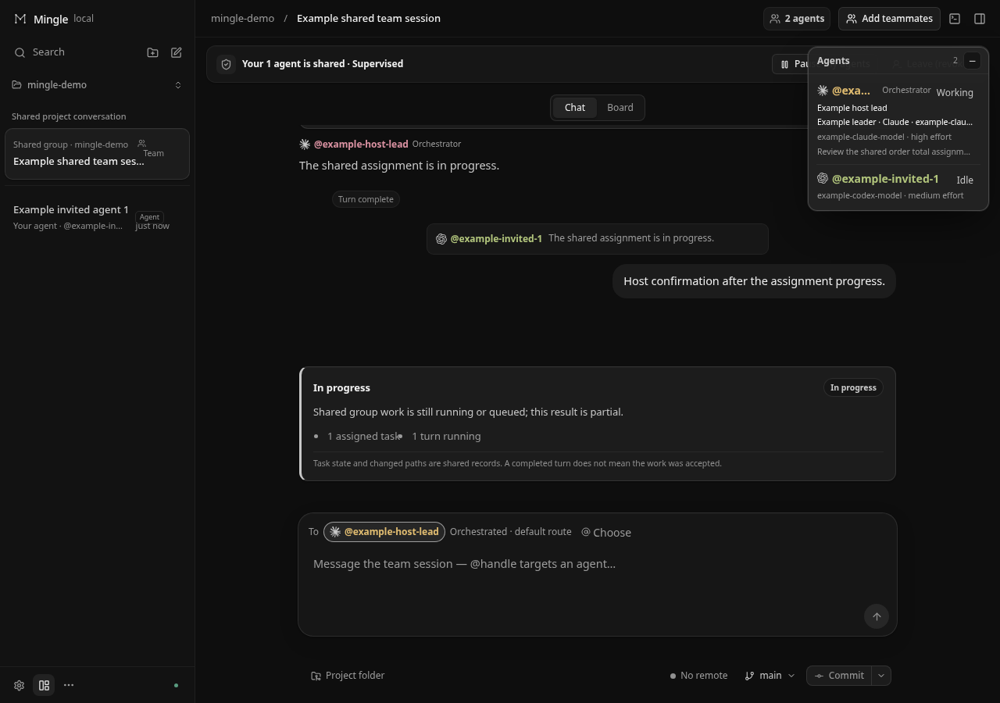
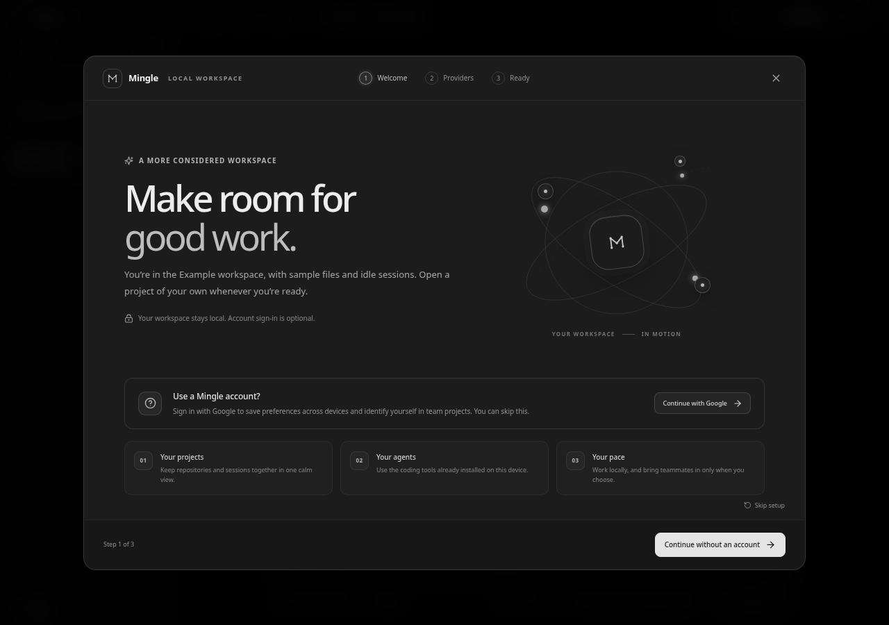
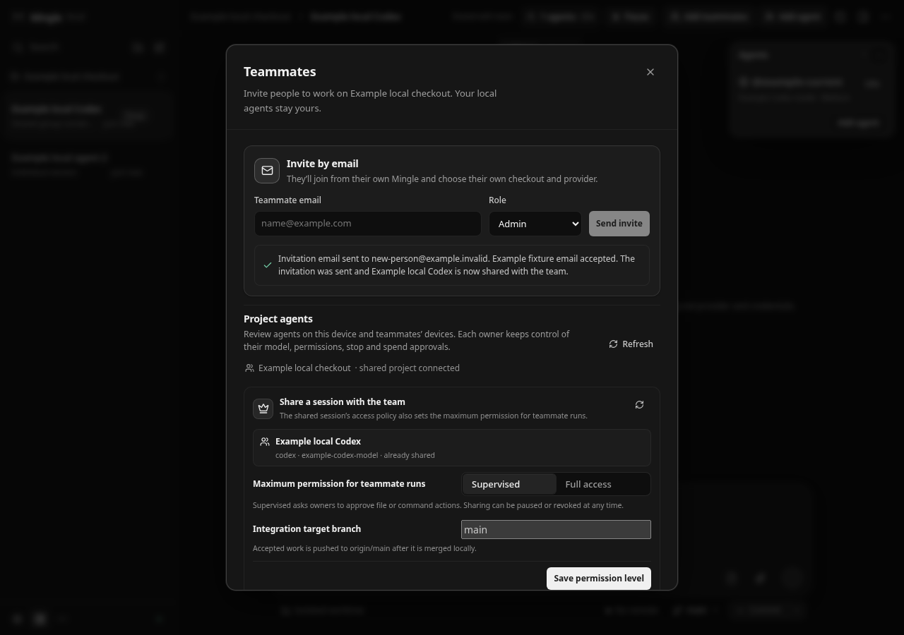

**Stop copying context between coding agents, terminals, and teammates.**

<p align="center">
  
</p>
<h1 align="center">Mingle</h1>
<p align="center">
  A shared workspace for your coding agents and your team.<br>
  Bring conversations, tasks, code, and handoffs together—on your computer and across your teammates’ devices.
</p>
<p align="center">
  <a href="https://github.com/AdithyanandanArun/Mingle-dev/releases/latest"></a>
  <a href="https://github.com/AdithyanandanArun/Mingle-dev/actions/workflows/ci.yml"></a>
  <a href="LICENSE"></a>
</p>
<p align="center">
  <a href="https://github.com/AdithyanandanArun/Mingle-dev/releases/latest">Download</a> ·
  <a href="#get-started">Get started</a> ·
  <a href="#work-as-a-team">Team workflow</a> ·
  <a href="ONBOARDING.md">Documentation</a> ·
  <a href="#contributing">Contribute</a>
</p>



<p align="center"><sub>The actual Mingle interface, shown with clearly labeled Example data. No live provider runs or cloud deliveries are depicted.</sub></p>

## One place to move the work forward

Working with several coding agents usually means relaying instructions, copying results, and keeping track of which chat changed which files. Adding teammates introduces another layer of accounts, machines, and handoffs.

Mingle brings that work into a desktop workspace. Start with one agent, add others to the conversation, and invite teammates when you want to collaborate. Keep the conversation connected to the tasks and code it produces.

| You want to… | Mingle helps you… |
| --- | --- |
| Use more than one provider | Run **Codex, Claude Code, OpenCode, and Antigravity** sessions in the same workspace, with their supported models and controls. |
| Let agents work together | Use a group conversation, address an agent with **@mentions**, and follow assignments, questions, and committed artifact handoffs. |
| See what your agent delegates | Follow automatically reported **subagents** and inspect their available activity and results. |
| Bring in a teammate | Invite them by email to a Git project. They choose their checkout and providers, then join the shared conversation from their device. |
| Keep changes separate | Use **isolated Git worktrees**, inspect diffs, and explicitly commit, push, or merge. |
| Work through a website together | Use the **shared browser** with your agent; interact directly in the embedded desktop browser to take control. |
| Know where things stand | See real tool activity, task progress, approvals, failures, and results. Finished work enters review rather than silently becoming accepted. |

## Get started

### Install the desktop app

[**Download the latest release →**](https://github.com/AdithyanandanArun/Mingle-dev/releases/latest)

| Platform | Download |
| --- | --- |
| Windows x64 | Per-user `.exe` installer |
| Ubuntu / Debian amd64 | `.deb` package |
| Arch Linux x86-64 | `.pkg.tar.zst` package |
| Other Linux x86-64 | `.tar.gz` archive; system dependencies are required |

Packages include Electron, Node, the local server, and the built UI. **Provider tools and provider accounts are configured separately.** Windows installers are currently unsigned; macOS packages and automatic updates are not available yet. See [installation and distribution](docs/desktop-distribution.md) for details.

1. **Open Mingle.** The welcome screen walks you through setup. A Mingle account is optional for local work.
2. **Connect a provider** in **Settings → Providers** and check its reported availability.
3. **Open your project** or create a local folder, then start a session. Git projects use isolated worktrees by default when a committed history is available.
4. **Add agents or teammates** when you need them. Choose permissions, send a task, and review the result.

<details>
<summary><strong>A look at the welcome experience</strong></summary>



</details>

### Provider setup

| Provider | Where to start |
| --- | --- |
| **Codex** | Install the Codex CLI and sign in with `codex login`. |
| **Claude Code** | Install Claude Code and sign in with `claude auth login`. Mingle uses the official Agent SDK with your local login. |
| **OpenCode** | Install OpenCode and configure its providers using its own login flow. Mingle connects through ACP. |
| **Antigravity** | Use **Settings → Providers** to install its runtime and sign in with Google. |

An installed executable does not guarantee authentication, quota, or access to every model. Mingle shows the provider’s reported capabilities and errors. An explicit `ANTHROPIC_API_KEY` overrides Claude’s saved login and uses API billing. See [provider coverage](docs/provider-feature-parity.md), [OpenCode](docs/provider-opencode.md), and [Antigravity](docs/provider-antigravity.md) for setup and differences.

## Work as a team

**Your project → your current conversation → Add teammates → one shared workspace.**

Open the conversation you want to share and choose **Add teammates**. Send an email invitation; the recipient opens Mingle, signs in with the invited account, selects or clones the repository, and adds their first agent. The current conversation becomes the shared team session. In a standalone session, its agent becomes the orchestrator; an existing group keeps its configured coordination mode.

Everyone can follow the shared conversation and address agents by handle. Each device owner chooses which agents to share and the permissions they grant, and can pause or revoke sharing. Joining a project or publishing an agent starts no model run by itself.

<details>
<summary><strong>See invitations and agent sharing</strong></summary>



</details>

Learn more about [project invitations](docs/project-teammates.md), [group conversations](docs/group-sessions.md), and [shared team sessions](docs/team-sessions.md).

## Your machine, your choices

- **Local by default.** Sessions, workspace history, and project files live on your computer. Prompts and selected context go to the provider you run; optional team features use cloud services.
- **Separate identities.** Your Mingle account is for collaboration. Provider authentication remains with the provider’s own tools.
- **Explicit permissions.** Supervised and Full access controls stay visible. Remote work remains subject to the relevant owner’s consent; Git push and merge have their own approval paths.
- **Visible state.** Availability, failures, and quota errors are surfaced. Worktrees separate edits; they are not operating-system sandboxes.

Mingle is under active development. Provider support differs, distributed features need the configured collaboration services, and cross-device responsiveness depends on connectivity. Current behavior and validation limits are documented in the linked guides and [acceptance records](docs/validation.md).

## Run from source

You’ll need **Git**, **Node.js 24.13+**, and **pnpm 11.26.0**. Native terminal dependencies may need Python and a C++ build toolchain.

```sh
git clone https://github.com/AdithyanandanArun/Mingle-dev.git
cd Mingle-dev
pnpm install --frozen-lockfile
pnpm dev
```

Open **http://127.0.0.1:5173**. The local API runs on **127.0.0.1:4310**. The initial Example workspace starts no paid inference.

```sh
pnpm typecheck
pnpm test
pnpm build
pnpm smoke
```

Use `pnpm start` to serve the built app, or `pnpm desktop` after building to open the Electron development shell. Native package builds are documented in [desktop distribution](docs/desktop-distribution.md).

Built with **React · TypeScript · Vite · Node.js · WebSockets · SQLite · Electron**.

## Documentation

| Guide | What’s inside |
| --- | --- |
| [Onboarding](ONBOARDING.md) | Installation, first session, accounts, and contributor setup |
| [Group sessions](docs/group-sessions.md) | Agent roles, routing, tasks, handoffs, and recovery |
| [Shared browser](docs/shared-browser.md) | Browser setup, human/agent control, and platform limits |
| [Accounts](docs/accounts.md) | Sign-in, secure storage, and preferences |
| [Architecture](docs/architecture.md) | How the UI, runtime, provider processes, and persistence fit together |
| [Project context](CONTEXT.md) | Implementation state and handoff notes for developers |

## Contributing

Bug reports, UI feedback, documentation improvements, and pull requests are welcome. For a bug, include your Mingle version, operating system, reproduction steps, and screenshots where useful. Keep credentials and private project data out of reports.

Start with [the contributor setup](ONBOARDING.md) and [project instructions](AGENTS.md). Use focused checks for your changes; the automatic test suite uses local fixtures rather than paid model tasks.

## License

Mingle is released under the **[MIT License](LICENSE)**. Bundled dependencies retain their own licenses and notices, included in desktop packages.

The implementation is original. T3 Code is an architectural and UX research reference, not a source-code dependency.
